<h3 align="center">
  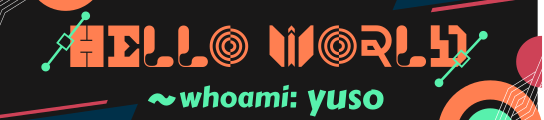
</h3>

<h1 align="center">
  
</h1>

<h5 align="center">
  <code><a href="https://yusouf.dev" title="Website"> yusouf.dev</a></code>
  <code><a href="https://x.com/yuso_sadick" title="X Profile"> X</a></code>
  <code><a href="https://www.linkedin.com/in/yuso-sadick/" title="LinkedIn Profile"> LinkedIn</a></code>
  <code><a href="https://www.instagram.com/yuso_sadick/" title="Instagram Profile"> Instagram</a></code>
</h5>
 

  Hi, I'm Yuso, Product Designer & Full-Stack Builder from Zanzibar, Tanzania 🇹🇿
   
  <i>Design it, build it, ship it: one person, whole product.</i>
   
   
  💻 I design and build the whole product: interface, code, backend, and the video that sells it
   
  🛠️ Day to day: Figma, React, Next.js, React Native / Expo, TypeScript, Tailwind, Supabase / PostgreSQL, Docker
   
  📸 Founder of <a href="https://eddypixel.com">EddyPixel</a>, a photo & video studio in Zanzibar
   
  🌴 Designed & built <a href="https://rostandzanzibar.com">Rostand Zanzibar</a> and <a href="https://zahorotours.com">Zahoro Tours</a>, booking sites for Zanzibar travel
   
  🎮 Building <a href="https://hasheemgaming.com">Hasheem Gaming</a>, a React Native marketplace for products & game accounts
   
  🌍 Working with clients worldwide
   
  💬 Ask me anything from <a href="https://github.com/yusosadick/yusosadick/issues" title="Issues">Here</a>
   
  📫 How to reach me: <a href="mailto:letsbuild@yusouf.dev">letsbuild@yusouf.dev</a> · <a href="https://yusouf.dev">yusouf.dev</a>

<h2 align="center">🛍️ Currently building: <a href="https://usetemplates.store">usetemplates.store</a></h2>

  Premium <b>React + Tailwind</b> website, dashboard & app templates, each with a <b>live preview</b> you can click through before you buy.

<table align="center">
  <tr>
    <td align="center" width="33%">
      <a href="https://hooma.usetemplates.store">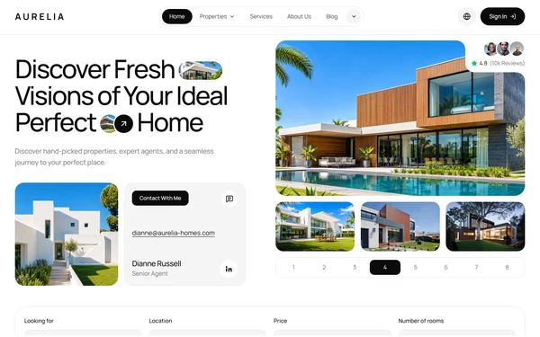</a>
       <b>Hooma</b> · Real-estate website
    </td>
    <td align="center" width="33%">
      <a href="https://boldfashion.usetemplates.store">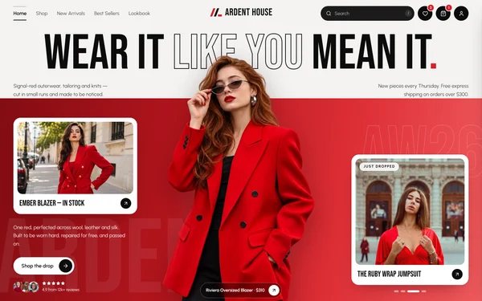</a>
       <b>Ardent House</b> · Fashion store
    </td>
    <td align="center" width="33%">
      <a href="https://sushi.usetemplates.store">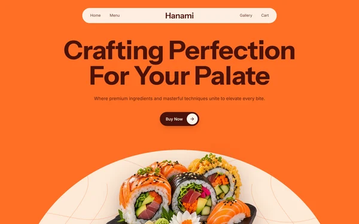</a>
       <b>Hanami</b> · Sushi restaurant
    </td>
  </tr>
  <tr>
    <td align="center" width="33%">
      <a href="https://aquaorix.usetemplates.store">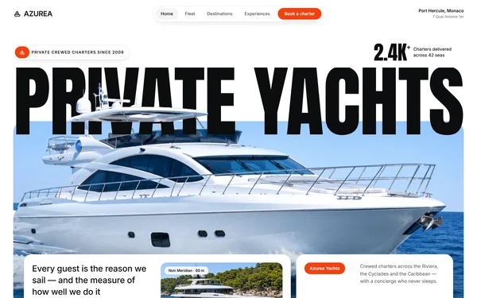</a>
       <b>Aqua Charter</b> · Yacht charter
    </td>
    <td align="center" width="33%">
      <a href="https://dash-realestatecrm.usetemplates.store">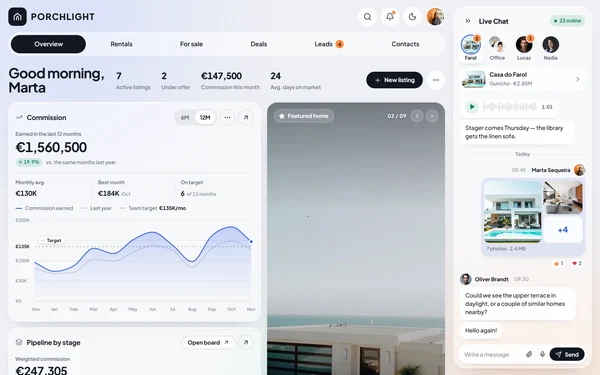</a>
       <b>Porchlight</b> · Real-estate CRM dashboard
    </td>
    <td align="center" width="33%">
      <a href="https://kit-authfun.usetemplates.store">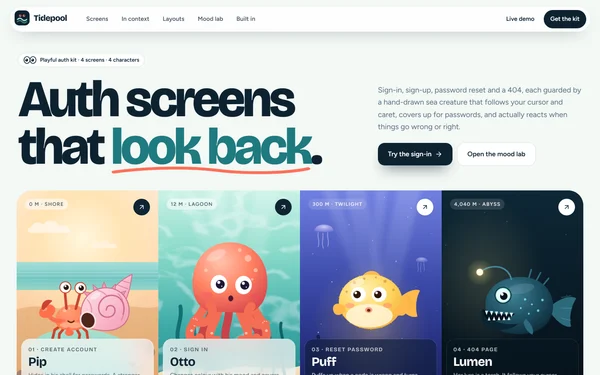</a>
       <b>Tidepool</b> · Auth screens kit
    </td>
  </tr>
</table>

  <a href="https://usetemplates.store"><b>Browse all templates →</b></a>

<h2 align="center">✍️ Latest writing</h2>

  <i>Notes on design, building and shipping websites, from <a href="https://usetemplates.store/blog">my blog</a>. Updates daily.</i>

<!-- BLOG-POST-LIST:START -->
- [Best Restaurant Website Templates &lpar;React + Tailwind&rpar; in 2026](https://usetemplates.store/blog/best-restaurant-website-templates-react-tailwind)
- [How to Choose a Website Template for a Small Business](https://usetemplates.store/blog/how-to-choose-a-website-template-for-a-small-business)
- [Deploy a React + Tailwind template to Vercel, Netlify or cPanel](https://usetemplates.store/blog/deploy-react-tailwind-template-vercel-netlify-cpanel)
- [Best SaaS Dashboard Templates for React &lpar;2026&rpar;](https://usetemplates.store/blog/best-saas-dashboard-templates-react)
- [Accepting Mobile Money on a Website in Tanzania](https://usetemplates.store/blog/accept-mobile-money-website-tanzania)<!-- BLOG-POST-LIST:END -->

<h2 align="center">🎬 Latest videos</h2>

  <i>Short build walkthroughs from <a href="https://www.youtube.com/@yusoufsadick">my YouTube channel</a>. Updates daily.</i>

<!-- YOUTUBE-VIDEO-LIST:START -->
- [Online ramen ordering website template — React + Tailwind &lpar;Noodle Ko&rpar;](https://www.youtube.com/watch?v=TOrZMx-UAYs)
- [Online ramen ordering website template — React + Tailwind &lpar;Noodle Ko&rpar;](https://www.youtube.com/shorts/xzVKyf-dTAg)
- [Bold burger restaurant website template — React + Tailwind &lpar;Molten Bros.&rpar;](https://www.youtube.com/watch?v=4EYLDOR-4f4)
- [Bold burger restaurant website template — React + Tailwind &lpar;Molten Bros.&rpar;](https://www.youtube.com/shorts/L5g-zrufI4M)
- [Sushi restaurant website template — React + Tailwind &lpar;Hanami Sushi&rpar;](https://www.youtube.com/watch?v=RxwYpEAxAgo)<!-- YOUTUBE-VIDEO-LIST:END -->

<h2 align="center">🔥 Languages & Frameworks & Tools & Abilities 🔥</h2>
 

  <code>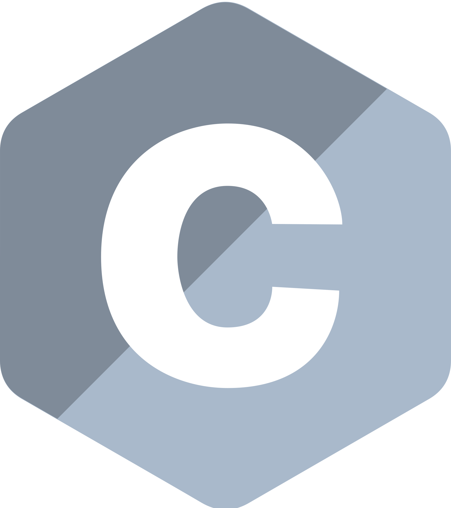</code>
  <code>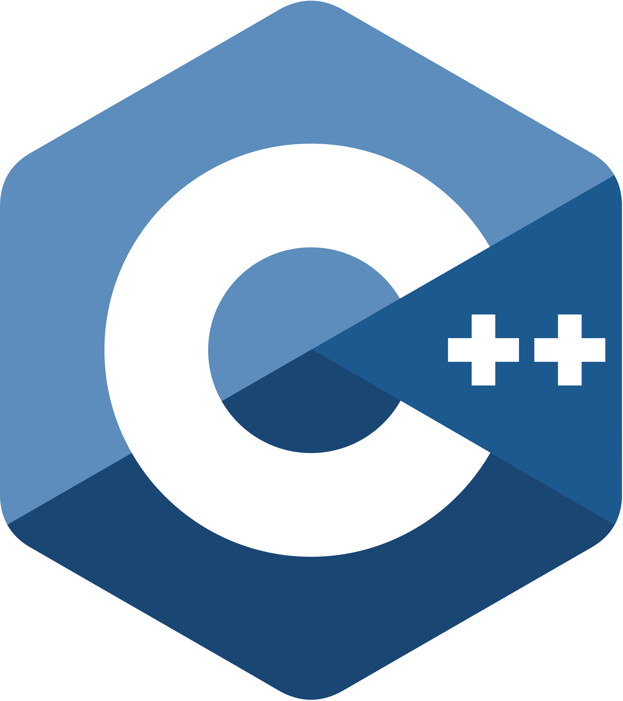</code>
  <code>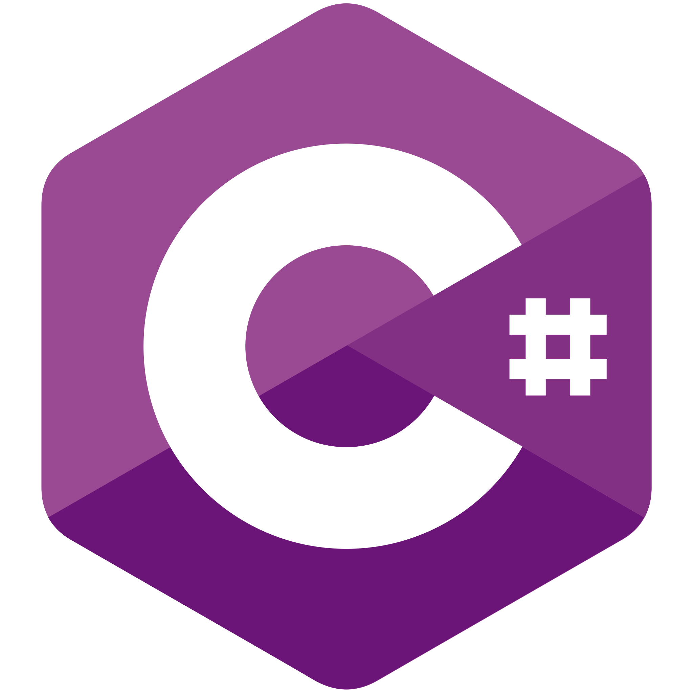</code>
  <code></code>
  <code></code>
  <code>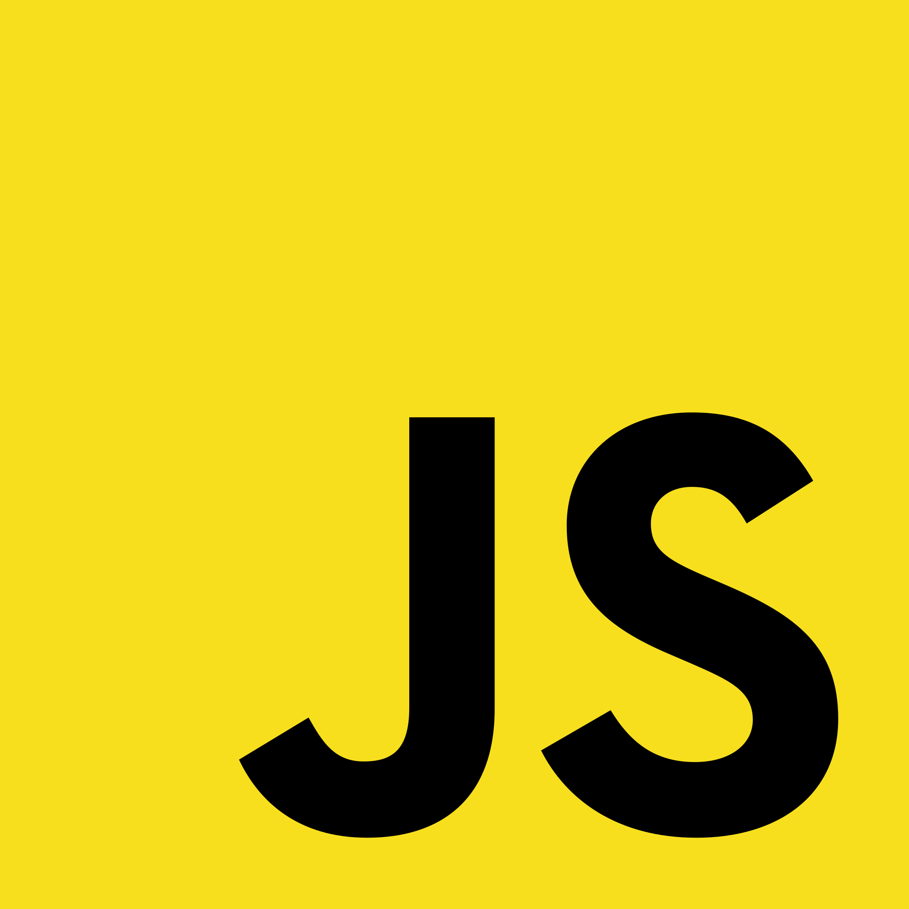</code>
  <!-- <code></code> -->
  <!-- <code></code> -->
  <code></code>
  <code></code>
  <code>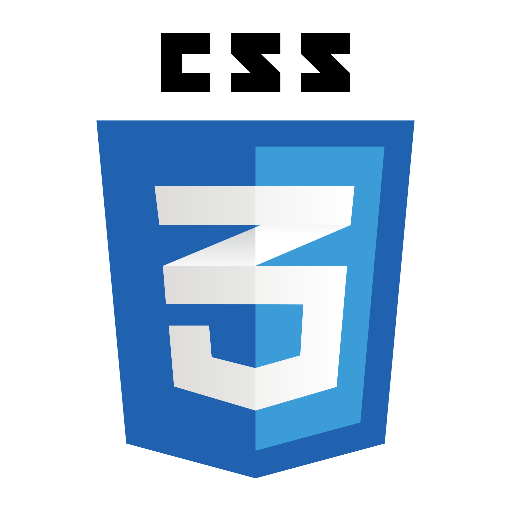</code>
  <code></code>
  <code></code>
  <code></code>
  <!-- <code></code> -->
  <code></code>
  <code>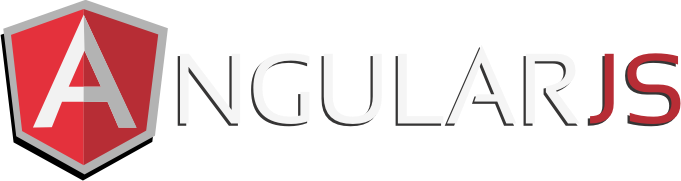</code>
  <code></code>
  <code>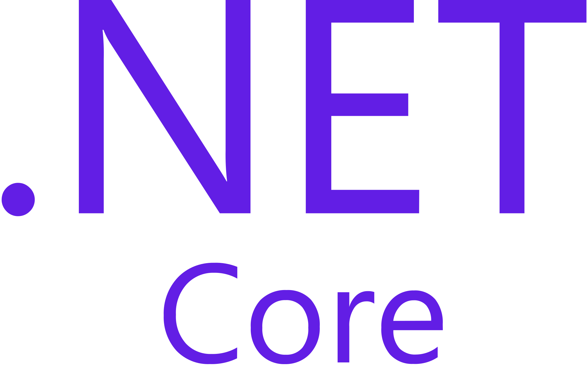</code>
  <code></code>
  <code>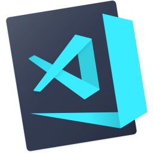</code>
  <code>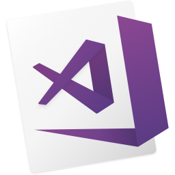</code>
  <code></code>
  <code></code>
  <code></code>
  <code></code>
  <code></code>
  <code></code>
  <code></code>
  <code></code>
  <code></code>
  <code></code>
  <!-- <code></code> -->

